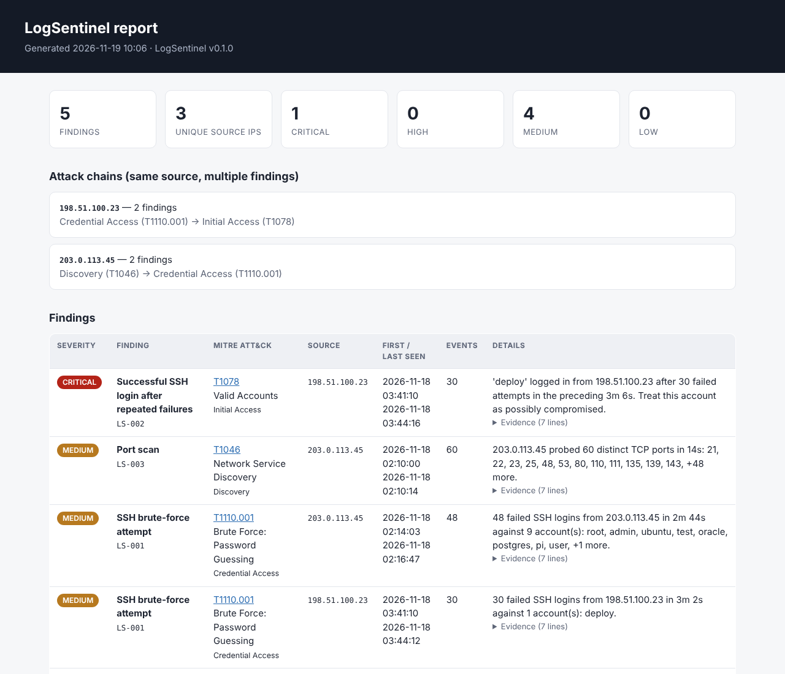
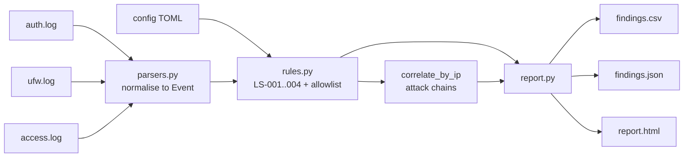

# LogSentinel

[](https://github.com/Joshua-error/logsentinel/actions/workflows/tests.yml)


**A lightweight log-based intrusion detector.** LogSentinel reads Linux SSH, firewall and
web server logs, detects brute-force attacks, port scans, compromised logins and web
content-discovery scans, and maps every finding to a **MITRE ATT&CK** technique. It then links
findings from the same attacker into an attack chain such as *Discovery → Credential Access*.

It is a small, readable version of what a SOC analyst's SIEM rules do. It is written in pure
Python with no dependencies and covered by 46 tests.



---

## Why I built this

Most security tooling I'd used was offensive (Kali, Burp, scanners from my VAPT internship).
I wanted to understand the **defender's side**: what those attacks actually look like in
logs, how a detection rule decides "this is an attack" versus "this is a user who mistyped their
password", and how analysts communicate findings using a shared framework like ATT&CK.

## Quick start

```bash
git clone https://github.com/Joshua-error/logsentinel.git && cd logsentinel
pip install -e .
logsentinel --auth sample_logs/auth.log --firewall sample_logs/ufw.log --web sample_logs/access.log --year 2026
```

Output:

```
Parsed 700 lines -> 605 security events (95 skipped)

5 finding(s):

  SEVERITY  RULE    ATT&CK     SOURCE IP        FIRST SEEN           TITLE
  CRITICAL  LS-002  T1078      198.51.100.23    2026-11-18 03:41:10  Successful SSH login after repeated failures
  MEDIUM    LS-003  T1046      203.0.113.45     2026-11-18 02:10:00  Port scan
  MEDIUM    LS-001  T1110.001  203.0.113.45     2026-11-18 02:14:03  SSH brute-force attempt
  MEDIUM    LS-001  T1110.001  198.51.100.23    2026-11-18 03:41:10  SSH brute-force attempt
  MEDIUM    LS-004  T1595.003  198.51.100.99    2026-11-18 11:22:04  Web content discovery scan

Attack chains:
  198.51.100.23: Credential Access (T1110.001) -> Initial Access (T1078)
  203.0.113.45: Discovery (T1046) -> Credential Access (T1110.001)

Reports written: reports/findings.csv, reports/findings.json, reports/report.html
```

Open `reports/report.html` in a browser for the full report with evidence lines.

## Detection rules

| ID | Detects | Logic (defaults, configurable) | MITRE ATT&CK | Severity |
|----|---------|--------------------------------|--------------|----------|
| LS-001 | SSH brute force | ≥ 5 failed logins from one IP within 60 s | [T1110.001](https://attack.mitre.org/techniques/T1110/001/) Brute Force: Password Guessing | Medium |
| LS-002 | Compromised login | A successful login from an IP with ≥ 3 failures in the previous 10 min | [T1078](https://attack.mitre.org/techniques/T1078/) Valid Accounts | Critical |
| LS-003 | Port scan | ≥ 10 *distinct* destination ports from one IP within 60 s | [T1046](https://attack.mitre.org/techniques/T1046/) Network Service Discovery | Medium |
| LS-004 | Web directory brute force | ≥ 15 *distinct* URLs returning 401/403/404 from one IP within 120 s. Raised to Medium if the User-Agent names a known tool (gobuster, nikto, sqlmap…) | [T1595.003](https://attack.mitre.org/techniques/T1595/003/) Active Scanning: Wordlist Scanning | Low / Medium |

**Burst detection.** All rate rules share one O(n) sliding-window function (`find_bursts`).
Overlapping windows are merged, so a 3-minute attack produces **one** finding, not 40.
The port-scan and web-scan rules count *distinct* ports or paths, so a client
retrying the same port 100 times is not reported as a scan.

**Attack chains.** Findings that share a source IP are ordered in time and shown as a
progression through ATT&CK tactics. In the sample data, `203.0.113.45` scans 60 ports and
then starts brute-forcing SSH four minutes later.

## Architecture



```
logsentinel/
├── parsers.py   # auth.log (BSD + ISO timestamps), UFW/iptables, Apache/Nginx combined; .gz support
├── rules.py     # detection rules, ATT&CK mapping, sliding-window bursts, correlation
├── config.py    # validated TOML thresholds + IP/CIDR allowlist
├── report.py    # CSV / JSON / HTML / console output
└── cli.py       # argparse entry point
sample_logs/     # synthetic day of logs with planted attacks (see below)
scripts/generate_sample_logs.py
tests/           # 46 pytest tests: parsers, every rule, report safety, end-to-end
```

## Usage

```bash
logsentinel --auth /var/log/auth.log --auth /var/log/auth.log.1 \
            --firewall /var/log/ufw.log \
            --web /var/log/nginx/access.log \
            --config logsentinel.toml --out reports/ --format html,json
```

| Option | Description |
|--------|-------------|
| `--auth`, `--firewall`, `--web` | Log files by type. Repeatable, and rotated `.gz` files work. |
| `-c, --config` | TOML file to override thresholds and set an allowlist. See [`logsentinel.example.toml`](logsentinel.example.toml). |
| `--year` | Year for syslog lines (BSD syslog omits it). Dec → Jan rollover is handled automatically. |
| `-o, --out` | Output directory (default `reports/`). |
| `-f, --format` | Any of `csv,json,html` (default: all). |
| `-q, --quiet` | No console summary. |

Exit codes: `0` success, `2` bad arguments, config, or missing file.

## Secure-by-design details

Log files are **attacker-controlled input**. An attacker chooses the username they try over
SSH and the URLs and User-Agent they send to your web server. LogSentinel treats that data as hostile:

- **No stored XSS in the report.** Every value is HTML-escaped. A test feeds the username
  `<script>alert(1)</script>` through the pipeline and checks that it is rendered inert.
- **No CSV formula injection.** Cells starting with `= + - @` are prefixed so Excel or Sheets
  shows them as text instead of executing them, for example a username like `=cmd|' /C calc'!A0`.
- **Strict parsing.** IP addresses are validated, and malformed lines are counted and skipped, never guessed.
- **Strict config.** Unknown keys (typos), non-positive thresholds and invalid CIDRs are rejected
  instead of silently falling back to defaults.

## Sample data and testing

`sample_logs/` is one synthetic day generated by
[`scripts/generate_sample_logs.py`](scripts/generate_sample_logs.py) (fixed seed, so it is reproducible).
It mixes normal traffic with planted scenarios. The end-to-end test asserts that **exactly**
these are detected:

| Time | Source | Scenario | Expected |
|------|--------|----------|----------|
| 02:10 | 203.0.113.45 | SYN scan of 60 ports | LS-003 |
| 02:14 | 203.0.113.45 | Brute force over 9 usernames | LS-001 |
| 03:41 | 198.51.100.23 | Brute force on `deploy`, then **successful login** | LS-001 + LS-002 |
| 05:00 | 203.0.113.77 | Low-and-slow brute force (1 try / ~12 min) | *Not detected (see limitations)* |
| 09:15 | 192.0.2.11 | Real user mistypes password twice, then logs in | No alert |
| 11:22 | 198.51.100.99 | gobuster directory scan, 40 paths | LS-004 |
| 14:02 | 192.0.2.27 | Visitor hits a few broken links | No alert |

All IPs are from the RFC 5737 documentation ranges.

```bash
pip install -e ".[dev]"
pytest -v
```

CI runs the suite on Python 3.11, 3.12 and 3.13 and uploads the sample report as a build artifact.

## Limitations (and what I'd do next)

Knowing a detector's blind spots matters as much as its rules:

- **Low-and-slow attacks evade rate rules.** The 05:00 attacker stays under 5 attempts per minute.
  *Next:* a second, long-window rule (for example ≥ 20 failures in 24 h), or per-IP baselining.
- **Distributed brute force** (many IPs, one account each) isn't correlated.
  *Next:* group failures by target username as well as by source IP.
- **Batch, not real time.** *Next:* a `--follow` mode that tails logs, and output to syslog or a webhook.
- **Fixed thresholds.** *Next:* learn a per-host baseline and alert on deviation.
- Planned rules: password spraying (T1110.003), new-country login using GeoIP,
  SQL injection and path-traversal patterns in URLs (T1190), and Sigma rule export.

## Ethics and scope

LogSentinel is a **defensive, read-only** tool. It only reads log files you give it and sends
nothing over the network. Use it on systems you own or are authorised to monitor. Logs can contain
personal data (usernames, IP addresses), so handle reports accordingly. The bundled sample data
is entirely synthetic.

## Author

**Joshua Pinto**, Cyber Security Engineering student, NMAM Institute of Technology
· [LinkedIn](https://www.linkedin.com/in/joshua-pinto-0b6073321) · [GitHub](https://github.com/Joshua-error)

Licensed under the [MIT License](LICENSE).
